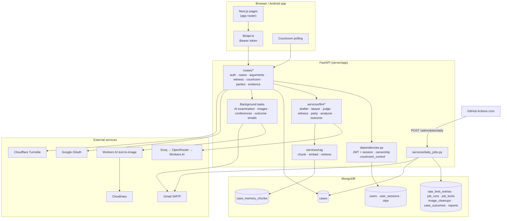
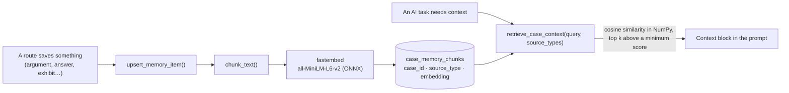
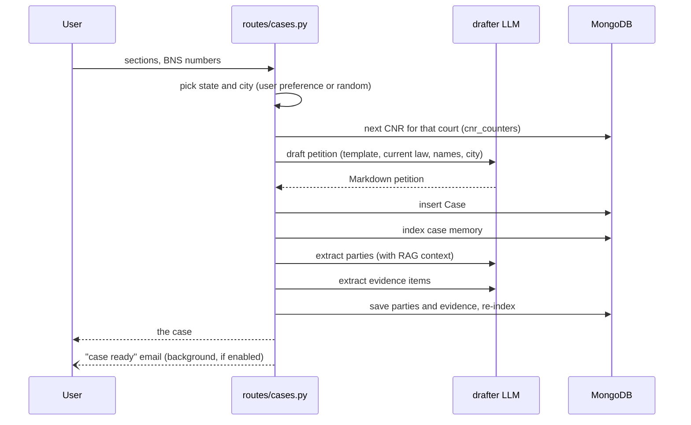
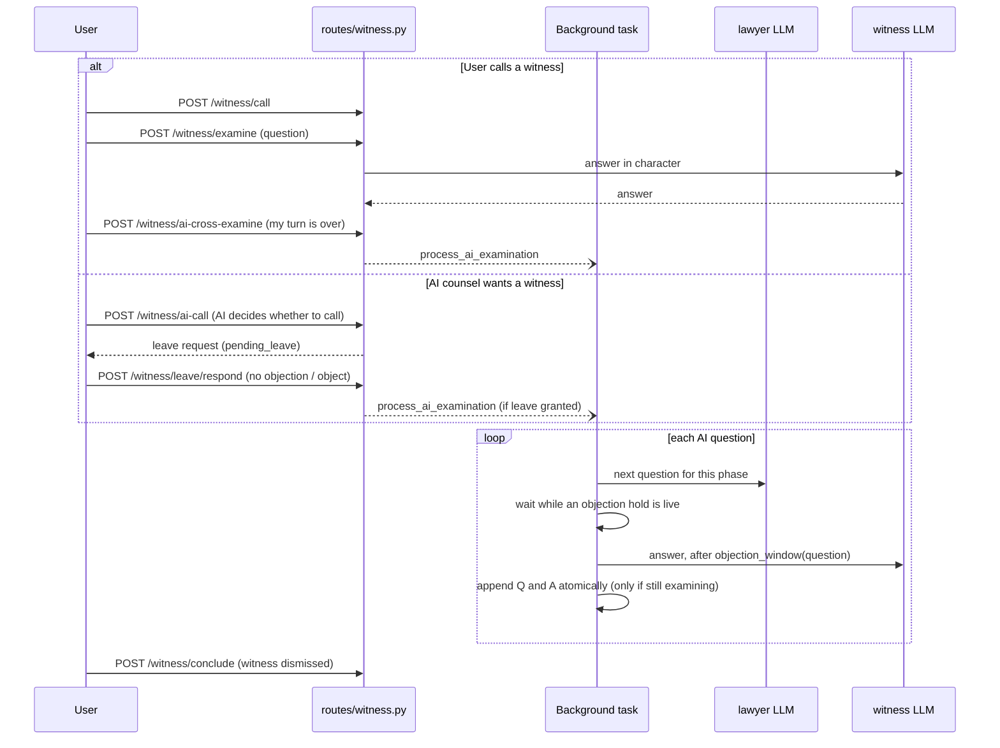
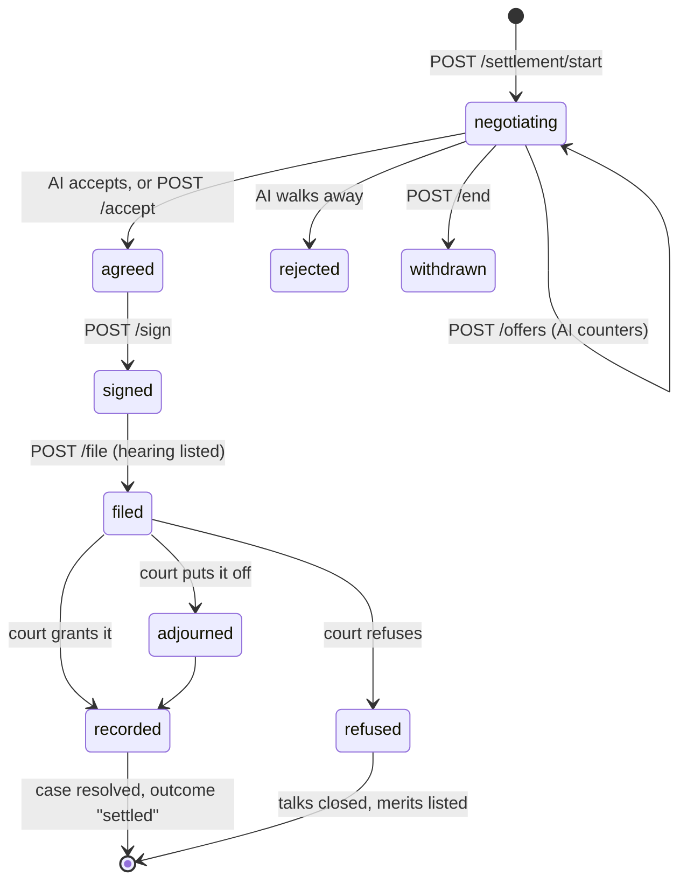

# Architecture

How AI Courtroom works, for people changing it. The [README](README.md) has the overview and setup; this document is the map: where things live, how the main flows run, and the rules the code relies on.

- [System at a glance](#system-at-a-glance)
- [Codemap](#codemap)
- [Requests, auth and sessions](#requests-auth-and-sessions)
- [The AI layer](#the-ai-layer)
- [Case memory (RAG)](#case-memory-rag)
- [Flows](#flows): [case generation](#case-generation) · [case prep](#case-prep) · [hearing](#the-hearing) · [objections](#objections) · [witnesses](#witnesses) · [judgment](#judgment) · [daily jobs](#daily-jobs)
- [Invariants](#invariants)
- [Testing](#testing)
- [Deployment](#deployment)

## System at a glance



One FastAPI process serves everything; there is no queue or worker. Slow work runs in FastAPI `BackgroundTasks` after the response is sent, and the client polls for its result.

## Codemap

### Server (`server/app`)

| Path                    | What it holds                                                                                                                                                                |
| ----------------------- | ---------------------------------------------------------------------------------------------------------------------------------------------------------------------------- |
| `main.py`               | The FastAPI app, middleware (request IDs and logging, CORS), router registration, startup (Beanie init, location cache preload)                                              |
| `config.py`             | Every setting, read from the environment with pydantic-settings; per-task model chains and limits live here                                                                  |
| `dependencies.py`       | `get_current_user` (JWT and session check), `get_owned_case`, and `courtroom_control` (one writer per hearing)                                                               |
| `messages.py`           | User-facing error strings in one place, so routes and tests use the same text                                                                                                |
| `models/`               | Beanie documents. `case.py` is the heart: the petition text, parties, evidence, arguments, `courtroom_proceedings` (the record), witness testimonies and hearing state       |
| `routes/`               | HTTP endpoints, one file per area. Routes validate, lock, call services and save                                                                                             |
| `services/llm/`         | One module per AI role. Each builds a prompt, calls `get_llm(task)` and parses the reply                                                                                     |
| `services/rag/`         | Case memory: `chunking.py`, `embedding.py` (fastembed), `service.py` (index, retrieve, fallback)                                                                             |
| `services/` (rest)      | Evidence and images, counsel conferences, outcomes and stats, settlement (deed, payments, progress), email, OTP, Google, Turnstile, purge, notifications, daily jobs, health |
| `utils/llm.py`          | `get_llm(task)`: the provider fallback chain, temperatures, health recording                                                                                                 |
| `utils/locks.py`        | Per-case `asyncio.Lock`s                                                                                                                                                     |
| `utils/rate_limiter.py` | MongoDB-backed per-user rate limits                                                                                                                                          |

### Client (`client/`)

| Path                                          | What it holds                                                                                                                                                                                                                                                         |
| --------------------------------------------- | --------------------------------------------------------------------------------------------------------------------------------------------------------------------------------------------------------------------------------------------------------------------- |
| `app/`                                        | Routes. `(app)/` shares the desk layout: `/cases`, `/cases/new`, `/cases/[cnr]` (case file), `/cases/[cnr]/case-prep`, `/cases/[cnr]/settlement`, `/cases/[cnr]/courtroom`, `/profile`. Public pages: landing, auth, documents, `/status`, `/contact`, `/unsubscribe` |
| `proxy.ts`                                    | Sends signed-out visitors on `/cases/*` and `/profile/*` to sign-in, and signed-in ones away from `/login` and `/register`                                                                                                                                            |
| `lib/api.ts`                                  | Axios client: attaches the Bearer token, maps errors, signs out on 401                                                                                                                                                                                                |
| `lib/settlement.ts`                           | The settlement's copy by route (desk, hearing, remedies, defaults) and its helpers                                                                                                                                                                                    |
| `lib/case-file.ts`                            | Reads the petition's Markdown into the seven-part case file (summary, parties, facts, charges, evidence, issues, prayer)                                                                                                                                              |
| `lib/three/`                                  | The 3D landing scene (three.js), kept close to the design handoff                                                                                                                                                                                                     |
| `components/court/`                           | Shared "courtroom paper" UI: scroller, confirm dialog, select, notice sheet, Markdown on paper, loaders                                                                                                                                                               |
| `components/cases/`, `components/landing/`, … | Feature components                                                                                                                                                                                                                                                    |
| `contexts/`                                   | Auth, settings, PWA install, cookie consent, client logger                                                                                                                                                                                                            |
| `e2e/`                                        | Playwright specs, fixtures (`support/fixtures.ts` mocks the API) and config                                                                                                                                                                                           |
| `capacitor.config.ts`                         | The Android shell: loads `CAP_SERVER_URL`                                                                                                                                                                                                                             |

## Requests, auth and sessions

- **Tokens.** Sign-in returns a JWT whose claims are the user id (`sub`) and a session id (`sid`). The client keeps it in `localStorage` and a cookie (the cookie lets `proxy.ts` see it) and sends it as `Authorization: Bearer`.
- **Sessions.** Each sign-in creates a `UserSession` (one per device). `get_current_user` rejects a token whose session was revoked, so signing out, "sign out other devices" and password changes take effect at once.
- **Rate limits.** A limit is checked before the work and used up after it, so a route under a per-user limit holds that user's lock for the limit until it returns (`RateLimiter.check_alone` / `hold`, with `scope="function"`); otherwise parallel requests to different cases would all pass the check. Limits before sign-in, which have no user to lock, reserve an attempt up front (`RateLimiter.reserve` / `release`), checked and recorded under a lock per (limit, key) that is dropped once unused. Both rely on the API running as one worker.
- **Sign-in methods.**
  - Email: password, then a six-digit code sent by email (`/auth/login/initiate` → `/auth/login/verify`). Registration confirms the address the same way (`/auth/register/initiate` → `/auth/register/verify`).
  - Google: the web authorization-code flow, or an ID token from the Android app's native sign-in, verified server-side. A signed `state` value protects the web flow.
  - Phone: OTP by SMS, behind `PHONE_AUTH_ENABLED`; off in production.
- **Case ownership.** `get_owned_case` returns 404 for unknown cases and 403 for other users' cases. It also adjourns a running hearing whose controlling session has expired.
- **Hearing control.** Routes that change a hearing use `controls_hearing`. It takes the case's lock, so one hearing action runs at a time, and only the device that started the hearing may act; another device must "take over" first.
- **Abuse limits.** Case generation, arguments, party chat, OTP sends, failed logins and client logs are rate-limited per user or IP in MongoDB. The signed-out contact form also needs a Turnstile token, checked for the `contact` action and an allowed hostname.

## The AI layer

`get_llm(task)` in `utils/llm.py` returns a LangChain runnable for one of eight tasks:

| Task       | Used for                                                                                                                                      |
| ---------- | --------------------------------------------------------------------------------------------------------------------------------------------- |
| `drafter`  | The petition; extracting parties and evidence from it; party details; evidence image prompts                                                  |
| `lawyer`   | AI counsel: openings, counter-arguments, closings, questions to its clients; witness questions; whether to call a witness; settlement replies |
| `judge`    | Rulings on objections, the verdict, and working out how a case can be settled                                                                 |
| `hearing`  | The court hearing a filed compromise. Fast models first (Groq), because the user waits on it                                                  |
| `witness`  | Witness answers on the stand                                                                                                                  |
| `party`    | Parties' replies in case prep chat                                                                                                            |
| `analyzer` | The courtroom and negotiation analyses, and summaries of long courtroom records                                                               |
| `outcome`  | Classifying the result for profile stats                                                                                                      |

Each task has a chain of up to four models (`*_MODEL`, `*_FALLBACK_MODEL`, `*_FALLBACK2_MODEL`, `*_FALLBACK3_MODEL`) across Groq, OpenRouter and Cloudflare Workers AI. A failure falls through to the next model with LangChain's `with_fallbacks`. Every call's success or failure is recorded in `services/health.py`, which drives the components on the public status page (generation, the courtroom, analysis).

Prompts live next to the service that sends them. They state the current law (BNS, BNSS and BSA, not the IPC, CrPC or Evidence Act) and ask for JSON when the code needs structure. `parse_llm_json` strips code fences and `<think>` blocks before parsing.

## Case memory (RAG)

Everything said or produced in a case is stored as memory chunks in `case_memory_chunks`: the petition, party bios, evidence, party chats, AI counsel's private conferences, arguments, the courtroom record, witness testimony and the verdict.



- Retrieval runs **in process**: a case's chunks are loaded and ranked with NumPy (dot product of normalised embeddings). Cases are small, so no vector index is needed. It filters by `source_type`, so the judge never sees AI counsel's private conferences, and a party only sees its own chats.
- Settlement talks are stored as `settlement` chunks, and only the analyses in `routes/case_analysis.py` retrieve them. See [Settlement](#settlement).
- Users can turn retrieval off in Settings. Prompts then get the full case text and the courtroom record instead (`_case_fallback_context`). The newest `FULL_TEXT_PROCEEDINGS_LIMIT` entries stay word for word, and older ones are summarised by the `analyzer` task.
- Missing or unembedded chunks are re-indexed on demand, so old cases still work.

## Flows

### Case generation

`POST /cases/generate` (`routes/cases.py`)



The petition is plain Markdown with fixed bold headers. The client's `lib/case-file.ts` reads it into the case file, tolerating the model's variations (dash-led party lines, lettered sub-points, annexures the extraction missed).

### Case prep

- **Choosing a side** (`PUT /cases/{cnr}/roles`) is final. It queues evidence images and starts AI counsel's private **conferences** with its own parties (`services/counsel_conferences.py`), both in the background.
- **Party bios** are written the first time a party is opened (`ensure_party_bio`). The same call rates the party's **payment reliability** (0–1: the chance they pay a settlement instalment on its due date, judged from their means and conduct). It is taken out of the bio, so the persona never speaks of it, and only developer accounts receive it; everyone else judges it from the background, as the model did. A bio written before the rating is rated once from the bio (`ensure_reliability`).
- **Party chat** (`POST /cases/{cnr}/parties/{id}/chat`): the `party` task answers in character. New facts in the answer can become **privileged notes** (`PN-01`, …), which go before the court only when counsel relies on them.
- **Evidence images**: `queue_image` marks visual exhibits pending, and `generate_queued_images` makes each one with Workers AI and uploads it to Cloudinary. Images stuck pending after a restart are released and retried; there is a per-case limit.

### The hearing

The case status moves through `not started → active ⇄ adjourned → resolved`.

```mermaid
sequenceDiagram
    participant U as User (device holding the hearing)
    participant API as routes/arguments.py
    participant L as lawyer LLM
    participant DB as MongoDB

    U->>API: PUT /status active
    Note over API: refused during the counsel recess after an adjournment
    U->>API: POST /arguments {role, argument, exhibit_refs}
    API->>API: courtroom_control: lock case, check device
    API->>API: opening if first statement; exhibits only in arguments
    API->>DB: record argument in the timeline
    API->>L: counter-argument (RAG: chats, evidence, record…)
    L-->>API: AI counsel's reply
    API->>DB: save both, update memory
    API-->>U: AI reply
    U->>API: PUT /status adjourned
    API--)L: AI counsel confers with its parties (background)
```

The court's own lines ("Court is in session", "Court adjourned…", "Judgment delivered") are written by `Case.log`. If the controlling session expires, the hearing is adjourned automatically the next time the case is read.

### Objections

`POST /cases/{cnr}/objections` (`routes/courtroom.py`)

1. **Hold.** Opening the Object dialog posts `/objections/hold`, which sets `objection_pending_at` for up to 5 minutes. While a hold is live, the AI examiner does not post its next question, and a witness answer waits.
2. **Checks.** The target must be the other side's argument or question, the grounds must suit it, it must not have been objected to already, and the hearing must not have moved on.
3. **Ruling.** Leading questions in cross-examination are overruled without the LLM. Otherwise the `judge` task rules and gives reasons.
4. **Record.** If sustained, the target is marked `struck` (or `withdrawn` for a question), along with the answer it drew. The objection and ruling events are then appended. These are **two separate writes**; see [Invariants](#invariants).

### Witnesses

Examination follows BSA s.143: the calling side examines in chief, the other side cross-examines, and the calling side may re-examine on matters raised in cross. Then the witness is discharged.



- When AI counsel asks a question, the answer waits an **objection window** so you can object: 5 s plus 1 s per 15 characters of the question, capped at 20 s.
- The client polls `GET /witness/current` and the case while the AI examines.
- Arguments and closings are refused (409) while a witness is on the stand or leave is pending.

### Judgment

`POST /cases/{cnr}/closing-statement`: the user's closing, then AI counsel's closing, then the `judge` writes a reasoned verdict from both sides' arguments, the exhibits and the testimony (RAG). The case becomes `resolved`. After the response is sent, `ensure_outcome` classifies the result once and records it in `case_outcomes` for the profile stats. `POST /cases/{cnr}/analyze-case` produces the separate case analysis.

### Settlement

A criminal case can be settled out of court, the way a compromise works in India: the accused and the complainants agree terms, sign a deed, file it, and a court decides whether the law lets it act on them.

| File                                                  | Does                                                                                                                        |
| ----------------------------------------------------- | --------------------------------------------------------------------------------------------------------------------------- |
| `routes/settlement.py`                                | The desk (`/cases/{cnr}/settlement/*`), the hearing, payments, and the courtroom's ask for time                             |
| `services/llm/settlement.py`                          | The route (`assess_settlement`), AI counsel's replies, the hearing (`hold_hearing`), the negotiation analysis               |
| `services/settlement_deed.py`                         | The deed as a template from the agreed terms; the hearing date; the court calling a filed compromise                        |
| `services/settlement_payments.py`                     | The schedule (an instalment a day), the draws against the accused's reliability, and the timeline worked out when read      |
| `services/settlement_progress.py`                     | Acts on the timeline once each: emails, the AI complainants moving the court on a default, the court's direction met or not |
| `client/components/settlement/simulated-payments.tsx` | The payments panel in the courtroom's rail: the timeline, notice, the default before the court, the outcome                 |
| `client/app/(app)/cases/[cnr]/settlement`             | The settlement desk: route card, negotiation log, offer panel, deed with animated signatures                                |

**The route.** On the first visit, one `judge` call reads the case file and returns a `SettlementProfile`, cached on the case: the route (`quash` under s.528 BNSS in the High Court, `compound` under s.359 BNSS, `plea` under ss.289–295 BNSS, or `none` with each route's reason for being closed), the offences, who must sign, and the conditions that fit the case (2–6, each with its deed clause). Heinous offences close quashing (_Laxmi Narayan_); quashing follows _Gian Singh_ and _Narinder Singh_.



1. **Talks.** Only while the court isn't sitting (`not started` or `adjourned`); in the courtroom, counsel asks for time with `POST /settlement/adjourn` (granted while talks can open; refused on a second ask; a signed deed always gets time). The accused opens: when the user acts for the complainants, AI counsel makes the first offer. Terms are structured (`SettlementTerms`: amount, instalments, months, interest, condition keys), snapped to the allowed values by the server. Limits: `MAX_OFFERS` user offers per attempt, `MAX_ATTEMPTS` attempts per case, and a new attempt needs the court to have sat since the last one ended.
2. **Deed.** Agreed terms become a deed from a template (no LLM call). Every signatory signs, then the deed is filed and the hearing listed `HEARING_GAP` later, on a working day.
3. **Hearing.** Heard in the courtroom, on the same record as the case. When the court next sits, `call_the_matter` lists the filed compromise and the court calls it. Counsel's submission goes to `hold_hearing` (the `hearing` task) with the record so far; it returns the hearing's lines (the State, each complainant questioned, the court), the court's checks, an outcome and an order. Every line is appended to `courtroom_proceedings` as a `SETTLEMENT` event with a `tag`.
   - **Granted:** the order becomes `case.verdict`, the case is resolved with `settlement_result` (`quashed`, `compounded`, `plea`), `record_settlement` writes the `settled` ledger row without the classifier, and the payments start.
   - **Adjourned:** re-listed for another date.
   - **Refused:** as in real practice, talks close and the court lists the matter for hearing on the merits.
4. **Payments.** The accused pays on their own (the user's client when the user defends), simulated on real days: an instalment falls due each day from the day after the order. When the order is passed, `draw` decides once, against the accused's payment reliability, whether each instalment is paid on time and, if missed, whether it is paid within the notice the deed gives, and whether the accused pays what the court later directs. The draws (`Settlement.plan`) never leave the server. `timeline` works out each instalment's status from the draws and today; nothing runs on a timer.

   What follows a default is what the law allows on each route. A quashing order can't be recalled for a breach of the compromise (s.403 BNSS bars a review), so the accused's promise to pay is an undertaking to the High Court, and its wilful breach is civil contempt. Compounding is an acquittal; a default only gives a claim on the deed in a civil court. Plea-bargain compensation is part of the sentence and is recovered as a fine (s.461 BNSS). The deed and the order say so.

   ```mermaid
   stateDiagram-v2
       [*] --> paying: order passed
       paying --> notice: instalment missed
       notice --> paying: paid within notice (late)
       notice --> defaulted: unpaid after notice
       paying --> closed: last instalment paid
       defaulted --> enforcement: contempt (quash) or recovery (plea), listed in this court
       defaulted --> suit: compound, a suit on the deed elsewhere
       enforcement --> suit: court leaves it to a civil suit
       enforcement --> closed: balance paid as directed, or levied under a warrant
       enforcement --> punished: contempt, the balance unpaid
   ```

   `settlement_progress.catch_up` acts on the timeline once each, with a marker on the settlement in one atomic update: it emails the owner (missed, paid late, closed, back in court), and on a default the user defends against it has the AI complainants move the court (listed `LIST_AFTER` later) or sue on the deed. When the user acts for the complainants, they file it (`POST /settlement/enforcement/file`). On the day it is listed, either side addresses the court (`POST /settlement/enforcement`, the `hearing` task): time to pay, a last chance to purge the contempt, a warrant to levy, or relegation to a civil suit. On the day the court gave, the accused pays the balance or the contempt is punished. The case stays `resolved` throughout; the hearing goes on its record. `catch_up` runs on reading the case, the case list and the settlement desk, and from the daily jobs. Developer accounts can play a day forward (`POST /settlement/next-day`).

   Orders passed before the simulation keep their months-long schedule, manual deposits and `defaults_on`.

5. **Negotiation analysis.** `POST /cases/{cnr}/analyze-negotiation`, once the case is resolved and the user negotiated. The `analyzer` task scores four factors (terms won 50%, deal closed 25%, offers used 15%, conditions 10%); the server weights them and sets the tier. It also gives the best terms the other side would likely have taken, and whether settling beat fighting it out. Saved on `case.negotiation` and copied to the ledger row by `record_negotiation` for the negotiator rating. The courtroom analysis (`analyze-case`) leaves the talks out.

**Stats.** `User.settled_scoring` decides how a settled case counts toward win % and streaks: left out (default), a win, or a win at a negotiator score of 70 or more (a loss below; left out until scored). The profile's negotiator rating averages the last ten scores, provisional under five. A score saved before the ledger kept scores is copied in when the stats are read.

### Daily jobs

GitHub Actions (`.github/workflows/daily-jobs.yml`) calls `POST /admin/jobs/daily` with `JOBS_TOKEN` once a day. `services/daily_jobs.py`:

1. Takes a lock in `job_locks`, so overlapping runs skip. The lock is deleted on release.
2. Runs each step and records it in `job_runs`. One step failing does not stop the others.

| Step                  | What it does                                                                                                                                                |
| --------------------- | ----------------------------------------------------------------------------------------------------------------------------------------------------------- |
| `purge_notices`       | Emails accounts 3 days before their 30-day erasure                                                                                                          |
| `purge`               | Erases accounts deleted over 30 days ago: photo, cases and their images, memory, outcomes, sessions, OTPs, rate-limit keys; contact messages are anonymised |
| `image_cleanups`      | Retries Cloudinary deletions that failed earlier (`delete_or_queue`)                                                                                        |
| `hearing_reminders`   | One email per adjournment when a case has waited 7 days                                                                                                     |
| `settlement_payments` | Catches every settlement order's payments up (`settlement_progress`) and emails owners what happened                                                        |
| `announcements`       | Sends queued product-update emails in batches, with one-click unsubscribe tokens                                                                            |

## Invariants

Rules the code depends on. Breaking one usually passes the tests on mongomock and fails in production.

- **Never `$set` an element of an array and `$push` to the same array in one update.** MongoDB rejects it (code 40); mongomock allows it. The objection route does two writes for this reason. Updates touching _different_ arrays are fine.
- **Append to `courtroom_proceedings` with `$push`, not by saving the whole case,** when background work may be writing at the same time (the AI examiner, objections). Saving a stale copy would drop the other writer's events.
- **Indexes into `courtroom_proceedings` stay valid,** because the record is append-only. Entries are struck or withdrawn, never removed.
- **One writer per hearing.** Use `controls_hearing` on any route that changes a hearing. The lock is in-process (`asyncio.Lock`), which is correct while the API runs as a single instance; running several instances would need a shared lock.
- **Function-scoped hearing lock.** It is released when the route returns, not when its background tasks finish. Otherwise Object would queue behind a running AI examination.
- **The simulation's values stay on the server.** A party's reliability and a settlement's draws (`plan`, `defaults_on`) are in `Case.HIDDEN`; pass it to `model_dump` wherever a whole case or its settlements go out (the case view, the data export). Only developers get the reliability, from the parties API.
- **Private memory stays private.** Retrieval filters by `source_type` and party; AI counsel's conferences never reach the judge's prompts.
- **Settlement talks are without prejudice.** Every `retrieve_case_context` call must list its `source_types`, and only `routes/case_analysis.py` may list `settlement`. `tests/unit/test_settlement.py` parses the code to enforce this. The offers never reach the record; a filed compromise and its hearing do, as they would in court.
- **Current law only.** Prompts and fixtures cite the BNS, BNSS and BSA.

## Testing

| Layer               | How                                                                                                                                                                                                                                   |
| ------------------- | ------------------------------------------------------------------------------------------------------------------------------------------------------------------------------------------------------------------------------------- |
| Server unit and API | pytest with an ASGI client. `tests/conftest.py` swaps in a fake LLM (queued responses) and fake embeddings, blocks outbound HTTP, and blanks secrets from a developer `.env`                                                          |
| Database            | mongomock by default. Setting `TEST_MONGODB_URL` runs the same suite on a real MongoDB; CI does both                                                                                                                                  |
| Client end-to-end   | Playwright builds the app against an API origin that never answers; every call is mocked per test with `page.route`. Runs on desktop and mobile Chromium, with the 3D specs also on WebKit, and axe accessibility checks on each page |
| Static checks       | ruff, black, pyrefly (server); TypeScript and ESLint (client); knip for unused code                                                                                                                                                   |

Settlement payments run on real dates, so their tests build orders relative to today: the server tests with helpers like `days_ago` and a hand-made `PaymentPlan` (no randomness), the e2e specs with a `day(n)` in Asia/Kolkata time, as the server counts days. Each payment stage (paying, notice, defaulted, enforcement, punished, suit, closed) has a server test and a courtroom e2e test; `POST /settlement/next-day` (developers only) lets a person play one through by hand.

CI (`.github/workflows/ci.yml`) runs everything except knip on pushes to `main` and on pull requests; server coverage must stay at 97% or above. Run knip yourself with `pnpm dlx knip` in `client/`.

## Deployment

| Part       | Host                                      | How it updates                                                                                                  |
| ---------- | ----------------------------------------- | --------------------------------------------------------------------------------------------------------------- |
| Client     | Vercel                                    | Builds `client/` on every push to `main`                                                                        |
| Server     | Render (native Python service, no Docker) | Redeploys from GitHub when files under `server/` change on `main`; installs `requirements.txt` and runs Uvicorn |
| Database   | MongoDB Atlas                             | —                                                                                                               |
| Daily jobs | GitHub Actions cron                       | Calls the deployed API                                                                                          |
| Android    | GitHub Releases                           | A Capacitor shell that loads the live site; a new APK is needed only for native changes                         |

`server/Dockerfile` and `docker-compose.yml` are for local development only; production does not use them.
