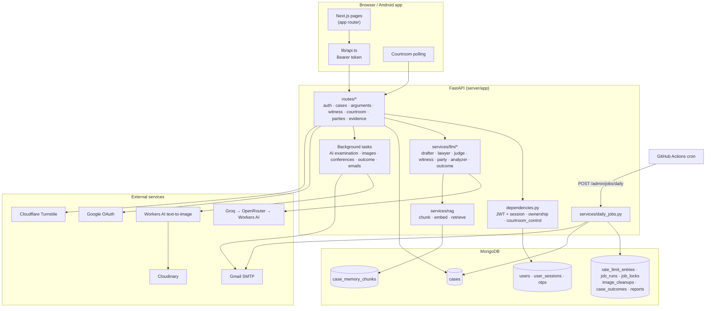
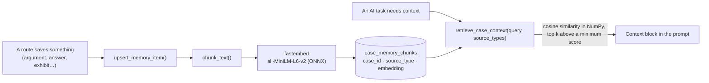
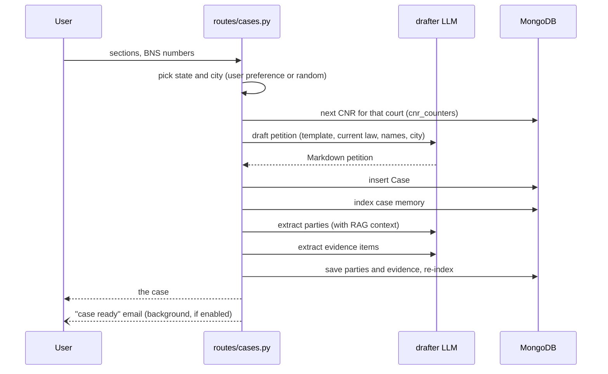
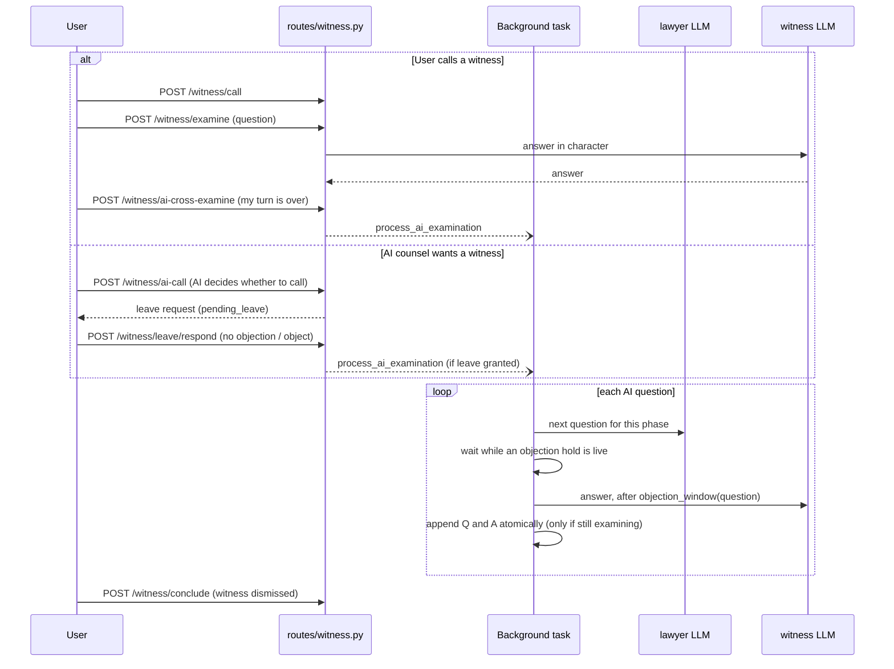

# Architecture

How AI Courtroom works, for people changing it. The [README](README.md) has the overview and setup; this document is the map: where things live, how the main flows run, and the rules the code relies on.

- [System at a glance](#system-at-a-glance)
- [Codemap](#codemap)
- [Requests, auth and sessions](#requests-auth-and-sessions)
- [The AI layer](#the-ai-layer)
- [Case memory (RAG)](#case-memory-rag)
- [Flows](#flows): [case generation](#case-generation) · [case prep](#case-prep) · [hearing](#the-hearing) · [objections](#objections) · [witnesses](#witnesses) · [judgment](#judgment) · [daily jobs](#daily-jobs)
- [Invariants](#invariants)
- [Testing](#testing)
- [Deployment](#deployment)

## System at a glance



One FastAPI process serves everything; there is no queue or worker. Slow work runs in FastAPI `BackgroundTasks` after the response is sent, and the client polls for its result.

## Codemap

### Server (`server/app`)

| Path | What it holds |
| --- | --- |
| `main.py` | The FastAPI app, middleware (request IDs and logging, CORS), router registration, startup (Beanie init, location cache preload) |
| `config.py` | Every setting, read from the environment with pydantic-settings; per-task model chains and limits live here |
| `dependencies.py` | `get_current_user` (JWT and session check), `get_owned_case`, and `courtroom_control` (one writer per hearing) |
| `messages.py` | User-facing error strings in one place, so routes and tests use the same text |
| `models/` | Beanie documents. `case.py` is the heart: the petition text, parties, evidence, arguments, `courtroom_proceedings` (the record), witness testimonies and hearing state |
| `routes/` | HTTP endpoints, one file per area. Routes validate, lock, call services and save |
| `services/llm/` | One module per AI role. Each builds a prompt, calls `get_llm(task)` and parses the reply |
| `services/rag/` | Case memory: `chunking.py`, `embedding.py` (fastembed), `service.py` (index, retrieve, fallback) |
| `services/` (rest) | Evidence and images, counsel conferences, outcomes and stats, email, OTP, Google, Turnstile, purge, notifications, daily jobs, health |
| `utils/llm.py` | `get_llm(task)`: the provider fallback chain, temperatures, health recording |
| `utils/locks.py` | Per-case `asyncio.Lock`s |
| `utils/rate_limiter.py` | MongoDB-backed per-user rate limits |

### Client (`client/`)

| Path | What it holds |
| --- | --- |
| `app/` | Routes. `(app)/` shares the desk layout: `/cases`, `/cases/new`, `/cases/[cnr]` (case file), `/cases/[cnr]/case-prep`, `/cases/[cnr]/courtroom`, `/profile`. Public pages: landing, auth, documents, `/status`, `/contact`, `/unsubscribe` |
| `proxy.ts` | Sends signed-out visitors on `/cases/*` and `/profile/*` to sign-in, and signed-in ones away from `/login` and `/register` |
| `lib/api.ts` | Axios client: attaches the Bearer token, maps errors, signs out on 401 |
| `lib/case-file.ts` | Reads the petition's Markdown into the seven-part case file (summary, parties, facts, charges, evidence, issues, prayer) |
| `lib/three/` | The 3D landing scene (three.js), kept close to the design handoff |
| `components/court/` | Shared "courtroom paper" UI: scroller, confirm dialog, select, notice sheet, Markdown on paper, loaders |
| `components/cases/`, `components/landing/`, … | Feature components |
| `contexts/` | Auth, settings, PWA install, cookie consent, client logger |
| `e2e/` | Playwright specs, fixtures (`support/fixtures.ts` mocks the API) and config |
| `capacitor.config.ts` | The Android shell: loads `CAP_SERVER_URL` |

## Requests, auth and sessions

- **Tokens.** Sign-in returns a JWT whose claims are the user id (`sub`) and a session id (`sid`). The client keeps it in `localStorage` and a cookie (the cookie lets `proxy.ts` see it) and sends it as `Authorization: Bearer`.
- **Sessions.** Each sign-in creates a `UserSession` (one per device). `get_current_user` rejects a token whose session was revoked, so "sign out other devices" and password changes take effect at once.
- **Sign-in methods.**
  - Email: password, then a six-digit code sent by email (`/auth/login/initiate` → `/auth/login/verify`). Registration confirms the address the same way (`/auth/register/initiate` → `/auth/register/verify`).
  - Google: the web authorization-code flow, or an ID token from the Android app's native sign-in, verified server-side. A signed `state` value protects the web flow.
  - Phone: OTP by SMS, behind `PHONE_AUTH_ENABLED`; off in production.
- **Case ownership.** `get_owned_case` returns 404 for unknown cases and 403 for other users' cases. It also adjourns a running hearing whose controlling session has expired.
- **Hearing control.** Routes that change a hearing use `controls_hearing`. It takes the case's lock, so one hearing action runs at a time, and only the device that started the hearing may act; another device must "take over" first.
- **Abuse limits.** Case generation, arguments, party chat, OTP sends, failed logins and client logs are rate-limited per user or IP in MongoDB. The signed-out contact form also needs a Turnstile token, checked for the `contact` action and an allowed hostname.

## The AI layer

`get_llm(task)` in `utils/llm.py` returns a LangChain runnable for one of seven tasks:

| Task | Used for |
| --- | --- |
| `drafter` | The petition; extracting parties and evidence from it; party details; evidence image prompts |
| `lawyer` | AI counsel: openings, counter-arguments, closings, questions to its clients; witness questions; whether to call a witness |
| `judge` | Rulings on objections, and the verdict |
| `witness` | Witness answers on the stand |
| `party` | Parties' replies in case prep chat |
| `analyzer` | The case analysis, and summaries of long courtroom records |
| `outcome` | Classifying the result for profile stats |

Each task has a chain of up to four models (`*_MODEL`, `*_FALLBACK_MODEL`, `*_FALLBACK2_MODEL`, `*_FALLBACK3_MODEL`) across Groq, OpenRouter and Cloudflare Workers AI. A failure falls through to the next model with LangChain's `with_fallbacks`. Every call's success or failure is recorded in `services/health.py`, which drives the components on the public status page (generation, the courtroom, analysis).

Prompts live next to the service that sends them. They state the current law (BNS, BNSS and BSA, not the IPC, CrPC or Evidence Act) and ask for JSON when the code needs structure. `parse_llm_json` strips code fences and `<think>` blocks before parsing.

## Case memory (RAG)

Everything said or produced in a case is stored as memory chunks in `case_memory_chunks`: the petition, party bios, evidence, party chats, AI counsel's private conferences, arguments, the courtroom record, witness testimony and the verdict.



- Retrieval runs **in process**: a case's chunks are loaded and ranked with NumPy (dot product of normalised embeddings). Cases are small, so no vector index is needed. It filters by `source_type`, so the judge never sees AI counsel's private conferences, and a party only sees its own chats.
- Users can turn retrieval off in Settings. Prompts then get the full case text and the courtroom record instead (`_case_fallback_context`). The newest `FULL_TEXT_PROCEEDINGS_LIMIT` entries stay word for word, and older ones are summarised by the `analyzer` task.
- Missing or unembedded chunks are re-indexed on demand, so old cases still work.

## Flows

### Case generation

`POST /cases/generate` (`routes/cases.py`)



The petition is plain Markdown with fixed bold headers. The client's `lib/case-file.ts` reads it into the case file, tolerating the model's variations (dash-led party lines, lettered sub-points, annexures the extraction missed).

### Case prep

- **Choosing a side** (`PUT /cases/{cnr}/roles`) is final. It queues evidence images and starts AI counsel's private **conferences** with its own parties (`services/counsel_conferences.py`), both in the background.
- **Party chat** (`POST /cases/{cnr}/parties/{id}/chat`): the `party` task answers in character. New facts in the answer can become **privileged notes** (`PN-01`, …), which go before the court only when counsel relies on them.
- **Evidence images**: `queue_image` marks visual exhibits pending, and `generate_queued_images` makes each one with Workers AI and uploads it to Cloudinary. Images stuck pending after a restart are released and retried; there is a per-case limit.

### The hearing

The case status moves through `not started → active ⇄ adjourned → resolved`.

```mermaid
sequenceDiagram
    participant U as User (device holding the hearing)
    participant API as routes/arguments.py
    participant L as lawyer LLM
    participant DB as MongoDB

    U->>API: PUT /status active
    Note over API: refused during the counsel recess after an adjournment
    U->>API: POST /arguments {role, argument, exhibit_refs}
    API->>API: courtroom_control: lock case, check device
    API->>API: opening if first statement; exhibits only in arguments
    API->>DB: record argument in the timeline
    API->>L: counter-argument (RAG: chats, evidence, record…)
    L-->>API: AI counsel's reply
    API->>DB: save both, update memory
    API-->>U: AI reply
    U->>API: PUT /status adjourned
    API--)L: AI counsel confers with its parties (background)
```

The court's own lines ("Court is in session", "Court adjourned…", "Judgment delivered") are written by `Case.log`. If the controlling session expires, the hearing is adjourned automatically the next time the case is read.

### Objections

`POST /cases/{cnr}/objections` (`routes/courtroom.py`)

1. **Hold.** Opening the Object dialog posts `/objections/hold`, which sets `objection_pending_at` for up to 5 minutes. While a hold is live, the AI examiner does not post its next question, and a witness answer waits.
2. **Checks.** The target must be the other side's argument or question, the grounds must suit it, it must not have been objected to already, and the hearing must not have moved on.
3. **Ruling.** Leading questions in cross-examination are overruled without the LLM. Otherwise the `judge` task rules and gives reasons.
4. **Record.** If sustained, the target is marked `struck` (or `withdrawn` for a question), along with the answer it drew. The objection and ruling events are then appended. These are **two separate writes**; see [Invariants](#invariants).

### Witnesses

Examination follows BSA s.143: the calling side examines in chief, the other side cross-examines, and the calling side may re-examine on matters raised in cross. Then the witness is discharged.



- When AI counsel asks a question, the answer waits an **objection window** so you can object: 5 s plus 1 s per 15 characters of the question, capped at 20 s.
- The client polls `GET /witness/current` and the case while the AI examines.
- Arguments and closings are refused (409) while a witness is on the stand or leave is pending.

### Judgment

`POST /cases/{cnr}/closing-statement`: the user's closing, then AI counsel's closing, then the `judge` writes a reasoned verdict from both sides' arguments, the exhibits and the testimony (RAG). The case becomes `resolved`. After the response is sent, `ensure_outcome` classifies the result once and records it in `case_outcomes` for the profile stats. `POST /cases/{cnr}/analyze-case` produces the separate case analysis.

### Daily jobs

GitHub Actions (`.github/workflows/daily-jobs.yml`) calls `POST /admin/jobs/daily` with `JOBS_TOKEN` once a day. `services/daily_jobs.py`:

1. Takes a lock in `job_locks`, so overlapping runs skip. The lock is deleted on release.
2. Runs each step and records it in `job_runs`. One step failing does not stop the others.

| Step | What it does |
| --- | --- |
| `purge_notices` | Emails accounts 3 days before their 30-day erasure |
| `purge` | Erases accounts deleted over 30 days ago: photo, cases and their images, memory, outcomes, sessions, OTPs, rate-limit keys; contact messages are anonymised |
| `image_cleanups` | Retries Cloudinary deletions that failed earlier (`delete_or_queue`) |
| `hearing_reminders` | One email per adjournment when a case has waited 7 days |
| `announcements` | Sends queued product-update emails in batches, with one-click unsubscribe tokens |

## Invariants

Rules the code depends on. Breaking one usually passes the tests on mongomock and fails in production.

- **Never `$set` an element of an array and `$push` to the same array in one update.** MongoDB rejects it (code 40); mongomock allows it. The objection route does two writes for this reason. Updates touching *different* arrays are fine.
- **Append to `courtroom_proceedings` with `$push`, not by saving the whole case,** when background work may be writing at the same time (the AI examiner, objections). Saving a stale copy would drop the other writer's events.
- **Indexes into `courtroom_proceedings` stay valid,** because the record is append-only. Entries are struck or withdrawn, never removed.
- **One writer per hearing.** Use `controls_hearing` on any route that changes a hearing. The lock is in-process (`asyncio.Lock`), which is correct while the API runs as a single instance; running several instances would need a shared lock.
- **Function-scoped hearing lock.** It is released when the route returns, not when its background tasks finish. Otherwise Object would queue behind a running AI examination.
- **Private memory stays private.** Retrieval filters by `source_type` and party; AI counsel's conferences never reach the judge's prompts.
- **Current law only.** Prompts and fixtures cite the BNS, BNSS and BSA.

## Testing

| Layer | How |
| --- | --- |
| Server unit and API | pytest with an ASGI client. `tests/conftest.py` swaps in a fake LLM (queued responses) and fake embeddings, blocks outbound HTTP, and blanks secrets from a developer `.env` |
| Database | mongomock by default. Setting `TEST_MONGODB_URL` runs the same suite on a real MongoDB; CI does both |
| Client end-to-end | Playwright builds the app against an API origin that never answers; every call is mocked per test with `page.route`. Runs on desktop and mobile Chromium, with the 3D specs also on WebKit, and axe accessibility checks on each page |
| Static checks | ruff, black, pyrefly (server); TypeScript and ESLint (client); knip for unused code |

CI (`.github/workflows/ci.yml`) runs everything except knip on pushes to `main` and on pull requests; server coverage must stay at 97% or above. Run knip yourself with `pnpm dlx knip` in `client/`.

## Deployment

| Part | Host | How it updates |
| --- | --- | --- |
| Client | Vercel | Builds `client/` on every push to `main` |
| Server | Render (native Python service, no Docker) | Redeploys from GitHub when files under `server/` change on `main`; installs `requirements.txt` and runs Uvicorn |
| Database | MongoDB Atlas | — |
| Daily jobs | GitHub Actions cron | Calls the deployed API |
| Android | GitHub Releases | A Capacitor shell that loads the live site; a new APK is needed only for native changes |

`server/Dockerfile` and `docker-compose.yml` are for local development only; production does not use them.
