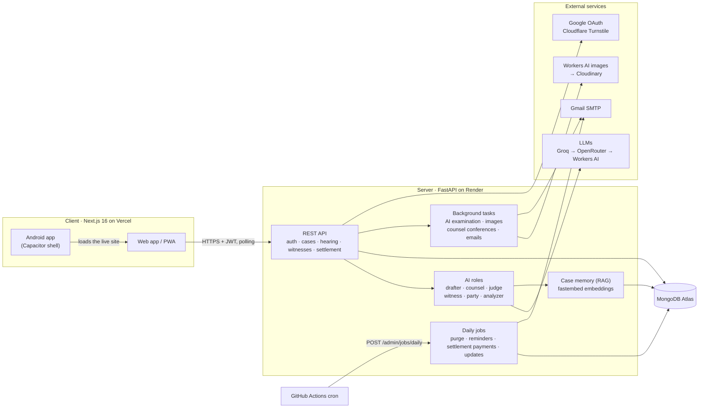

<!-- markdownlint-disable MD033 MD041 -- centred header and collapsible sections need HTML -->
<div align="center">


# AI Courtroom

**Practise advocacy in a simulated Indian High Court.**<br>
Take a side, argue against AI counsel, examine witnesses, object, settle, and hear a reasoned judgment.

[](https://github.com/ParthRana1023/AI-Courtroom/actions/workflows/ci.yml)
[](https://github.com/ParthRana1023/AI-Courtroom/releases/latest)


[](LICENSE.md)

[**Open the app**](https://ai-courtroom.vercel.app) ·
[**Download for Android**](https://github.com/ParthRana1023/AI-Courtroom/releases/latest/download/ai-courtroom.apk) ·
[Changelog](https://ai-courtroom.vercel.app/changelog) ·
[Report a bug](https://github.com/ParthRana1023/AI-Courtroom/issues) ·
[Security](SECURITY.md)

</div>

---

## What is AI Courtroom?

AI Courtroom drafts a realistic criminal case before a real Indian High Court, under the current laws (BNS, BNSS and BSA), and lets you argue it from start to finish. You choose a side; the AI plays opposing counsel, the witnesses and the judge. Every hearing follows courtroom procedure: openings, arguments, objections, witness examination, closings and a judgment that explains its reasoning.

It is built for law students, moot court teams and anyone who wants to practise thinking on their feet in court.

## Features

### Cases

- **Case generation:** choose the BNS sections, and the AI drafts a petition before a High Court with a real-format CNR number, parties, facts, grounds, evidence and a prayer. The court and city follow your location preference in Settings (your own state, a state you pick, or random).
- **Indexed case file:** the petition is read into seven parts: summary, parties, facts, charges, evidence, issues for the court, and prayer.
- **My Cases:** filter, search, archive and restore your cases; deleting asks first and can be undone.

### Case Prep

- **Interview the parties:** chat with each party before the hearing to build your theory of the case.
- **Exhibits:** evidence comes with AI-generated images, remade in the background if one fails.

### The courtroom

- **Arguments against AI counsel**, who answers your points and raises its own.
- **Objections ruled on live** by the AI judge: sustained remarks are struck from the record and questions withdrawn.
- **Witness examination:** call your witnesses, examine in chief, cross-examine the other side's, and object to their questions. When AI counsel wants a witness, it asks the court's leave and you can oppose it.
- **Adjourn and resume:** the record, the hearing's state and a case memory (retrieval-augmented) carry over between sessions.
- **Judgment and analysis:** a reasoned verdict, plus a written analysis of your arguments, witness examinations and client conferences.

### Settling out of court

A criminal case can be settled the way a compromise works in India, and what follows a settlement follows the law, not a game rule.

- **The settlement desk:** each case shows the routes the law leaves open (quashing under s.528 BNSS, compounding under s.359 BNSS, plea bargaining under ss.289–295 BNSS) or why each is closed. Trade structured offers with AI counsel: amount, instalments, months, interest and conditions.
- **Deed and hearing:** agreed terms become a compromise deed that every party signs. The court hears it in the courtroom, on the same record as the case, questions the complainants and grants, adjourns or refuses it. You can also ask the sitting court for time to settle.
- **Payments that play out:** after the order, the accused pays the instalments on their own, one a day. How reliably each party pays is judged from their background (a 0–1 number only developer accounts see), so read the background before you settle.
- **Defaults, as the law handles them:** a missed instalment gets notice under the deed; paid within it, nothing more comes of it. Left unpaid, the complainants act: a contempt petition for breach of the undertaking to the High Court (a quashing can't be recalled for a breach), recovery as a fine on a plea bargain (s.461 BNSS), or a suit on the deed in a civil court on compounding (the acquittal stands). You argue it before the court on the day it is listed; the court gives time, a last chance to pay or a warrant, and punishes contempt if the balance stays unpaid.
- **Negotiation analysis:** a score out of 100, the best deal the other side would likely have taken, and whether settling beat fighting it out, with a negotiator rating on your profile. You choose how settled cases count toward your win rate.

### Accounts and the rest

- Email and password, Google sign-in and one-time codes; profile, settings and notification preferences.
- Security: a session per device that ends on sign-out; codes that work once, limited per address and per network; AI limits that hold under parallel requests; logs that mask emails and keep no phone numbers; CodeQL on every change, and a sweep test (`server/tests/api/test_security_sweep.py`) that checks every case route refuses other accounts.
- Hearing reminders (including what happens to a settlement's payments) and optional product-update emails, each with one-click unsubscribe.
- Account deletion: the account is kept for 30 days (restorable on request through Contact → Account Recovery), then erased automatically.
- A 3D walk-through landing page (three.js) with a simple fallback for devices without WebGL.
- Installable as a PWA, and as an [Android app](https://github.com/ParthRana1023/AI-Courtroom/releases/latest).
- Public [status page](https://ai-courtroom.vercel.app/status), contact form protected by Cloudflare Turnstile, and pages checked for accessibility with axe in the end-to-end tests.

## Architecture



- **One API process, no queue:** slow AI work (witness examination, evidence images, AI counsel's private conferences) runs as background tasks after the response, and the client polls for it.
- **Fallback per AI task:** each role has its own chain of up to four models, so one provider being down or rate-limited doesn't stop a hearing.
- **Case memory:** everything said in a case is embedded and retrieved per prompt, filtered so private material (such as AI counsel's conferences) never reaches the judge.
- **No timers for settlements:** a settlement's payments are worked out from dates and draws made once at the order; what follows (emails, the complainants moving the court) is applied once, when the case is next read or by the daily jobs.
- **Android:** the app is a Capacitor shell that loads the live site, so most updates reach it without a new APK.

For the codemap, sequence diagrams of every flow (case generation, the hearing, objections, witnesses, judgment, settlement and its payments, daily jobs) and the rules the code relies on, see **[ARCHITECTURE.md](ARCHITECTURE.md)**.

## Tech stack

| Area               | Technology                                                                                                                      |
| ------------------ | ------------------------------------------------------------------------------------------------------------------------------- |
| Frontend           | Next.js 16 (App Router), React 19, TypeScript 6, Tailwind CSS 4, Radix UI, three.js                                             |
| Mobile and offline | Capacitor 8 (Android), Serwist (service worker / PWA)                                                                           |
| Backend            | FastAPI, Pydantic 2, Beanie ODM on PyMongo's async client                                                                       |
| Database           | MongoDB 8 (Atlas in production)                                                                                                 |
| AI                 | LangChain with per-task model chains on Groq, OpenRouter and Cloudflare Workers AI; fastembed (ONNX) embeddings for case memory |
| Services           | Google OAuth, Cloudinary, Cloudflare Turnstile, Gmail SMTP                                                                      |
| Testing            | pytest (mongomock and real MongoDB), Playwright (desktop, mobile, WebKit) with axe, ruff, black, pyrefly, ESLint                |
| Hosting            | Vercel (client), Render (server, native Python), GitHub Actions (CI and daily jobs)                                             |

## Getting started

### Prerequisites

- Node.js 24 and pnpm 11 or later
- Python 3.13
- MongoDB: a local server, or a free [Atlas](https://www.mongodb.com/atlas) cluster
- An API key for at least one LLM provider: [Groq](https://console.groq.com), [OpenRouter](https://openrouter.ai) or Cloudflare Workers AI

### 1. Clone

```bash
git clone https://github.com/ParthRana1023/AI-Courtroom.git
cd AI-Courtroom
```

### 2. Server

```bash
cd server
python -m venv venv
source venv/bin/activate          # Windows: venv\Scripts\activate
pip install -r requirements-dev.txt
cp .env.example .env              # then fill in the values below
uvicorn app.main:app --reload     # http://localhost:8000
```

The server refuses to start without these:

- `SECRET_KEY` and `OAUTH_STATE_SECRET`: random values of at least 32 characters each. Generate them with `python -c "import secrets; print(secrets.token_hex(32))"`.
- `email_username` and `email_password`: an SMTP login, such as a Gmail address with an app password. Sign-in codes are sent by email.

It also needs `MONGODB_URL` (it defaults to `mongodb://localhost:27017`) and at least one LLM key, such as `GROQ_API_KEY`, to generate cases. Everything else is optional and documented in [`server/.env.example`](server/.env.example).

<details>
<summary><b>Server environment variables</b></summary>

| Variable                                                                                  | Needed for                                                                                         |
| ----------------------------------------------------------------------------------------- | -------------------------------------------------------------------------------------------------- |
| `MONGODB_URL`, `MONGODB_DB_NAME`                                                          | Database                                                                                           |
| `SECRET_KEY`, `OAUTH_STATE_SECRET`                                                        | Signing sign-in tokens and the Google sign-in state (required, 32+ characters)                     |
| `email_username`, `email_password` (required); `email_sender`, `smtp_server`, `smtp_port` | Sign-in codes, password reset and reminder emails                                                  |
| `GROQ_API_KEY`, `OPENROUTER_API_KEY`, `CLOUDFLARE_ACCOUNT_ID` + `CLOUDFLARE_API_TOKEN`    | The AI; at least one provider                                                                      |
| `FRONTEND_URL`, `CORS_ALLOWED_ORIGINS`                                                    | Links in emails, and which sites may call the API                                                  |
| `GOOGLE_CLIENT_ID`, `GOOGLE_CLIENT_SECRET`                                                | Google sign-in                                                                                     |
| `CLOUDINARY_CLOUD_NAME`, `CLOUDINARY_API_KEY`, `CLOUDINARY_API_SECRET`                    | Profile photos and evidence images                                                                 |
| `CSC_API_KEY`                                                                             | Country, state and city lists for profile locations                                                |
| `TURNSTILE_SECRET_KEY`                                                                    | Robot check on the signed-out contact form                                                         |
| `JOBS_TOKEN`, `PUBLIC_API_URL`                                                            | The daily jobs endpoint and unsubscribe links                                                      |
| `*_MODEL`, `*_FALLBACK_MODEL`                                                             | Override the model chain for each task (drafter, lawyer, judge, witness, party, analyzer, outcome) |

Rate limits, RAG tuning and courtroom pacing are also configurable; see the comments in `.env.example`.

</details>

### 3. Client

```bash
cd client
pnpm install
cp .env.example .env              # set NEXT_PUBLIC_API_URL=http://localhost:8000
pnpm dev                          # http://localhost:3000
```

<details>
<summary><b>Client environment variables</b></summary>

| Variable                         | Purpose                                                                               |
| -------------------------------- | ------------------------------------------------------------------------------------- |
| `NEXT_PUBLIC_API_URL`            | The server's URL (required)                                                           |
| `NEXT_PUBLIC_GOOGLE_CLIENT_ID`   | Google sign-in (the server's Web client ID)                                           |
| `NEXT_PUBLIC_TURNSTILE_SITE_KEY` | Turnstile widget on the contact form                                                  |
| `NEXT_PUBLIC_PHONE_AUTH_ENABLED` | Phone sign-in; development only                                                       |
| `CAP_SERVER_URL`                 | The site the Android app loads (`.env` for dev, `.env.production` for release builds) |
| `NEXT_PUBLIC_APK_DOWNLOAD_URL`   | Override the Android download link                                                    |

</details>

### Docker (optional)

For local development only (production doesn't use Docker): `docker compose up --build` starts the server on port 8000 and the client on port 3000. It uses `server/.env` for its settings, so point `MONGODB_URL` at a database the container can reach, such as Atlas or `host.docker.internal`.

## Testing

```bash
# Server: lint, format, types and tests (CI requires 97% coverage)
cd server
ruff check . && black --check . && pyrefly check
python -m pytest --cov --cov-fail-under=97

# Run the same tests against a real MongoDB instead of the in-memory fake
TEST_MONGODB_URL=mongodb://localhost:27017 python -m pytest

# Client: types, lint and end-to-end tests (builds the app against a mocked API)
cd client
pnpm exec tsc --noEmit && pnpm lint
pnpm test:e2e                     # desktop, mobile and WebKit
pnpm test:e2e:fast                # desktop only
```

The server tests use a fake LLM and fake embeddings and block third-party APIs, so they need no keys. CI runs every check on each push to `main` and on every pull request.

## Android app

Users download the APK from the [latest release](https://github.com/ParthRana1023/AI-Courtroom/releases/latest); the website's **Install app** button links straight to it.

<details>
<summary><b>Building a release APK</b></summary>

1. `cd client && pnpm build:android`. This syncs the Android project using `.env.production`, so the app opens the live site.
2. Increase `versionCode` and set `versionName` in `android/app/build.gradle`.
3. Run `npx cap open android`, then use **Build → Generate Signed App Bundle / APK → APK** with your release keystore. Keep the keystore out of the repo and backed up.
4. Rename the output to `ai-courtroom.apk` and attach it to a new GitHub release marked as the latest.

Google sign-in in the app needs an **Android** OAuth client for `com.aicourtroom.app` with your release key's SHA-1.

</details>

## Deployment

| Part       | Where          | Notes                                                                                                                                                                                             |
| ---------- | -------------- | ------------------------------------------------------------------------------------------------------------------------------------------------------------------------------------------------- |
| Client     | Vercel         | Deploys `client/` from `main`; set the `NEXT_PUBLIC_*` variables                                                                                                                                  |
| Server     | Render         | Native Python service connected to this repo; redeploys when files under `server/` change on `main`. Build: `pip install -r requirements.txt`; start: Uvicorn. Set the server variables in Render |
| Daily jobs | GitHub Actions | [`daily-jobs.yml`](.github/workflows/daily-jobs.yml) calls the API once a day; needs the `API_URL` and `JOBS_TOKEN` repository secrets                                                            |

## Project structure

```text
AI-Courtroom/
├── client/                   Next.js app
│   ├── app/                  Routes: landing, auth, (app)/cases, courtroom, docs, status
│   ├── components/           UI, grouped by feature (cases, court, landing, contact, …)
│   ├── lib/                  API client, case-file reader, 3D scene, config
│   ├── e2e/                  Playwright specs, fixtures and config
│   └── capacitor.config.ts   Android shell settings
├── server/                   FastAPI app
│   ├── app/
│   │   ├── routes/           Auth, account, cases, courtroom, witness, arguments, admin, …
│   │   ├── services/         LLM tasks, RAG memory, evidence images, email, daily jobs
│   │   ├── models/           Beanie documents
│   │   └── schemas/          Request and response models
│   ├── tests/                Unit and API tests
│   ├── requirements.txt      Runtime dependencies (pinned)
│   └── requirements-dev.txt  Runtime plus test and lint tools
├── .github/workflows/        CI and daily jobs
├── docker-compose.yml        Local development only
├── ARCHITECTURE.md           How the system works, in depth
└── SECURITY.md
```

## Contributing

Issues and pull requests are welcome. By submitting a contribution, you agree to the terms in section 4 of the [LICENSE](LICENSE.md): the copyright holder may use and relicense it, including commercially. Before opening a pull request:

1. Run the server and client checks from [Testing](#testing); CI runs the same ones.
2. Add or update tests with the change: pytest for the server, a Playwright spec for anything a user sees.
3. Keep secrets out of commits. `.env` files and keystores are git-ignored; keep them that way.

## Security

Please report vulnerabilities privately, as described in [SECURITY.md](SECURITY.md), not in public issues.

## License

AI Courtroom is **source-available, not open source**. Under the [AI Courtroom Personal Use License](LICENSE.md), individuals may download, run, study and modify it for their own personal, non-commercial use.

You may not:

- share or publish the code or your modified versions, except to propose changes to this repository;
- host it for other people;
- use it commercially;
- use it for or on behalf of an organization.

The "AI Courtroom" name and logo are not licensed. For any other use, including commercial licensing, contact [@ParthRana1023](https://github.com/ParthRana1023).

## Disclaimer

AI Courtroom is a practice tool. Its cases, arguments and judgments are generated by AI for training and are not legal advice.
